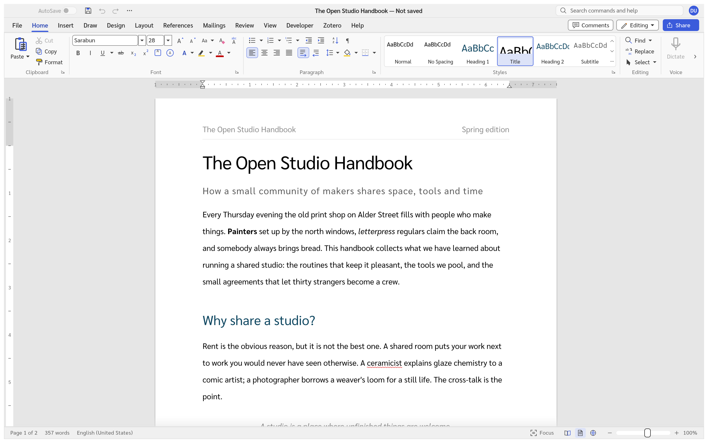
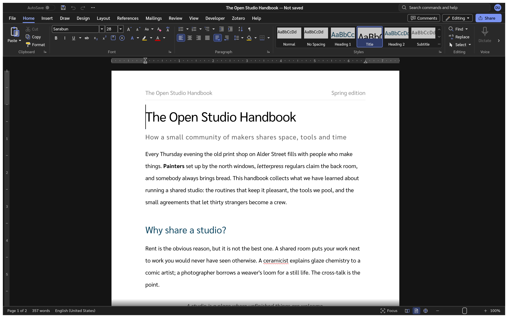

# Doc4Me

Doc4Me is a clean-room, open-source word processor written in Rust. It aims for complete parity
with Microsoft Word, then goes further on speed, openness and agent control: every feature is a
command that scripts and AI agents can run, over a local control channel or MCP.

It is in **alpha**: see [ROADMAP.md](ROADMAP.md) for what works today and what is left.



## ภาษาไทย

Doc4Me 1.1.0 มีหน้าจอภาษาไทยครบทุกเมนู ใช้ฟอนต์สารบรรณ (Sarabun) เป็นฟอนต์หลัก ตัดคำไทยด้วยพจนานุกรม
มีตัวตรวจตัวสะกดไทยและเลขลำดับไทย ระยะบรรทัดวัดแบบเดียวกับ Word บน Windows และเอกสารที่ใช้
TH Sarabun New จะแสดงขนาดเท่าต้นฉบับแม้เครื่องไม่มีฟอนต์นั้น


## Download

Windows x64 builds (an MSI installer and a portable zip) are on the
[Releases](https://github.com/chatraweechai/doc4me/releases) page. They are not code-signed yet, so
Windows SmartScreen may ask before it runs them. The MSI installs over earlier Doc4Me versions.

On macOS, Linux and BSD, build it from source (below). Packaging scripts for macOS, Linux and the
web build are in [`packaging/`](packaging/).

## Highlights

- Opens and saves `.docx`, RTF, ODT, HTML, Markdown, LaTeX and plain text; reads `.doc`; exports
  PDF.
- A Word-style ribbon, styles, lists, tables, equations, SmartArt, charts, comments and tracked
  changes, references and citations (with Zotero), mail merge and Reading Mode.
- Interface in English, Thai, Russian, Hungarian, Turkish, Italian and other languages.
- Light and dark themes; in the dark theme the page stays white.
- `doc4me-cli` converts and edits documents without a window, and `doc4me-cli mcp` serves every
  command to AI agents ([docs/mcp.md](docs/mcp.md)).



## Build from source

Install Rust 1.90 or newer, then:

```sh
cargo run --release -p doc4me                 # the app
cargo run --release -p doc4me -- --sample     # the app with the sample document
cargo run --release -p doc4me-cli -- convert in.docx out.pdf
```

Before sending a change, run `cargo xtask ci` (format, clippy, tests, assets, layering and the
WebAssembly build). How the code is organised: [docs/architecture.md](docs/architecture.md);
rules for contributors and agents: [AGENTS.md](AGENTS.md); releases:
[docs/releasing.md](docs/releasing.md); what changed: [CHANGELOG.md](CHANGELOG.md).

## Licence

Doc4Me is licensed under either of [MIT](LICENSE-MIT) or [Apache-2.0](LICENSE-APACHE), at your
option. The bundled fonts are under the SIL Open Font License and the Thai word-break data under
the [Unicode licence](LICENSE-UNICODE); see [NOTICE](NOTICE) and [ATTRIBUTION.md](ATTRIBUTION.md)
for every third-party component.

Doc4Me is an independent project, not affiliated with or endorsed by Microsoft. It contains no
Microsoft icons, images, templates or other assets. The screenshots above are of Doc4Me itself.
