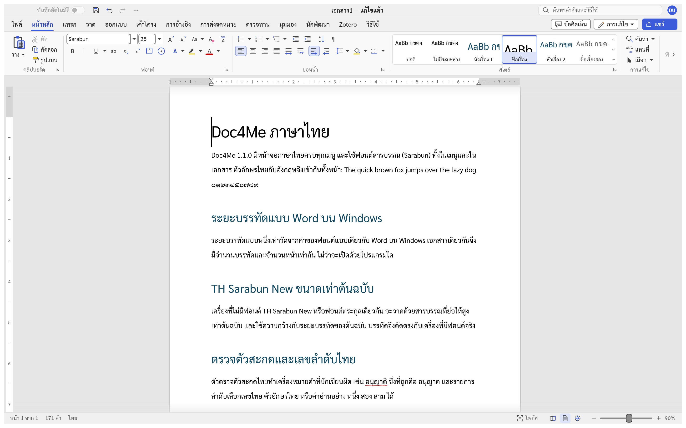
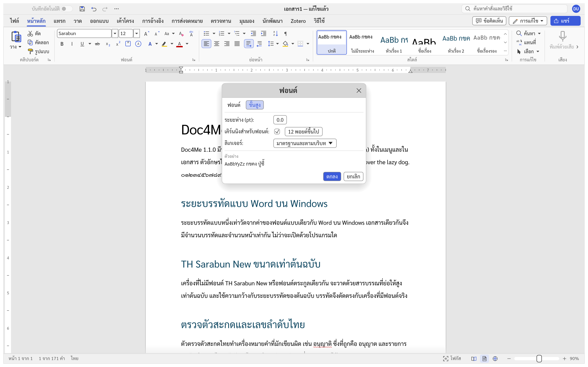
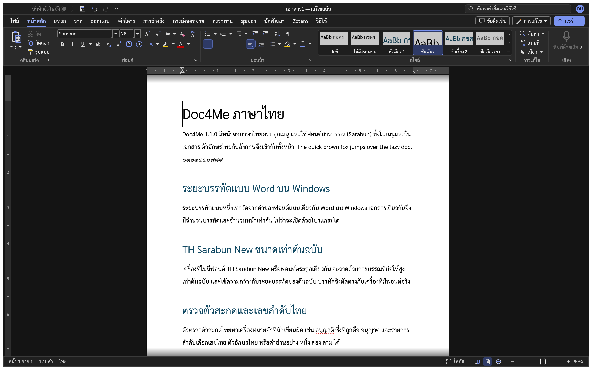

# Doc4Me

[English](README.md) · **ภาษาไทย**

Doc4Me เป็นโปรแกรมประมวลผลคำแบบโอเพนซอร์สที่เขียนด้วยภาษา Rust และพัฒนาแบบ clean room
ตั้งเป้าให้ทำได้ครบเท่า Microsoft Word แล้วไปให้ไกลกว่านั้นในเรื่องความเร็ว ความเปิดกว้าง
และการสั่งงานด้วย agent ทุกความสามารถเป็นคำสั่งที่สคริปต์และ AI agent เรียกใช้ได้ ผ่านช่องควบคุมในเครื่องหรือ MCP

ตอนนี้อยู่ในระยะ **alpha** ดูว่าทำอะไรได้แล้วและเหลืออะไรบ้างที่ [ROADMAP.md](ROADMAP.md)



## ภาษาไทยใน Doc4Me 1.1.0

- หน้าจอภาษาไทยครบทุกเมนู ใช้ฟอนต์สารบรรณ (Sarabun) เป็นฟอนต์หลักทั้งในเมนูและในเอกสาร
- ตัดคำไทยด้วยพจนานุกรม ทั้งตอนขึ้นบรรทัดใหม่ ดับเบิลคลิกเลือกคำ และนับจำนวนคำ
- ตัวตรวจตัวสะกดไทยทำเครื่องหมายคำที่มักเขียนผิด เช่น อนุญาติ (ที่ถูกคือ อนุญาต)
- รายการลำดับเลือกเลขไทย ตัวอักษรไทย หรือคำอ่านอย่าง หนึ่ง สอง สาม ได้
- ระยะบรรทัดแบบหนึ่งเท่าวัดแบบเดียวกับ Word บน Windows เอกสารเดียวกันจึงมีจำนวนหน้าเท่ากัน
- เอกสารที่ใช้ TH Sarabun New, TH SarabunPSK หรือ TH SarabunIT๙ แสดงขนาดเท่าต้นฉบับแม้เครื่องไม่มีฟอนต์นั้น

## ดาวน์โหลด

ตัวติดตั้งสำหรับ Windows x64 (MSI และไฟล์ zip แบบไม่ต้องติดตั้ง) อยู่ในหน้า
[Releases](https://github.com/chatraweechai/doc4me/releases) ไฟล์เหล่านี้ยังไม่ได้ลงลายเซ็นดิจิทัล
Windows SmartScreen จึงอาจถามก่อนเปิด ตัวติดตั้ง MSI ติดตั้งทับ Doc4Me เวอร์ชันก่อนหน้าได้

บน macOS, Linux และ BSD ให้ build จากซอร์สโค้ด (ดูด้านล่าง) สคริปต์สร้างแพ็กเกจสำหรับ macOS, Linux
และเวอร์ชันเว็บอยู่ใน [`packaging/`](packaging/)

## ความสามารถหลัก

- เปิดและบันทึก `.docx`, RTF, ODT, HTML, Markdown, LaTeX และข้อความธรรมดา อ่าน `.doc` และส่งออกเป็น PDF
- แถบคำสั่งแบบ Word สไตล์ รายการ ตาราง สมการ SmartArt แผนภูมิ ข้อคิดเห็นและการติดตามการเปลี่ยนแปลง
  การอ้างอิงและบรรณานุกรม (ใช้กับ Zotero ได้) จดหมายเวียน และโหมดอ่าน
- หน้าจอภาษาไทย อังกฤษ รัสเซีย ฮังการี ตุรกี อิตาลี และภาษาอื่น ๆ
- ธีมสว่างและธีมมืด ในธีมมืดหน้ากระดาษยังเป็นสีขาว
- `doc4me-cli` แปลงและแก้ไขเอกสารได้โดยไม่ต้องเปิดหน้าต่าง และ `doc4me-cli mcp` ให้ AI agent
  เรียกใช้ทุกคำสั่งได้ ([docs/mcp.md](docs/mcp.md))

### เคิร์นนิงและลิเกเจอร์

หน้าขั้นสูงของกล่องฟอนต์ตั้งค่า "เคิร์นนิงสำหรับฟอนต์" และลิเกเจอร์ได้ และบันทึกไว้ใน `.docx` แบบเดียวกับ Word
ข้อความที่ไม่ได้ตั้งค่านี้ใช้ค่าเริ่มต้นแบบ Word คือไม่เคิร์นนิง และไม่ใช้ลิเกเจอร์กับอักษรละติน
(อักษรที่มีการประกอบรูป เช่น อาหรับและไทย ใช้ลิเกเจอร์ของฟอนต์เสมอ)



### ธีมมืด



## Build จากซอร์สโค้ด

ติดตั้ง Rust เวอร์ชัน 1.90 ขึ้นไป แล้วรัน

```sh
cargo run --release -p doc4me                 # เปิดโปรแกรม
cargo run --release -p doc4me -- --sample     # เปิดโปรแกรมพร้อมเอกสารตัวอย่าง
cargo run --release -p doc4me-cli -- convert in.docx out.pdf
```

ก่อนส่งการแก้ไข ให้รัน `cargo xtask ci` (จัดรูปแบบโค้ด clippy เทสต์ asset การแบ่งชั้นของโค้ด และ build
WebAssembly) โครงสร้างของโค้ดดูที่ [docs/architecture.md](docs/architecture.md) กติกาสำหรับผู้ร่วมพัฒนาและ agent
ดูที่ [AGENTS.md](AGENTS.md) การออกเวอร์ชันดูที่ [docs/releasing.md](docs/releasing.md) และสิ่งที่เปลี่ยนแปลง
ดูที่ [CHANGELOG.md](CHANGELOG.md) คำแปลและอภิธานศัพท์ของหน้าจอภาษาไทยดูที่
[docs/localization-th.md](docs/localization-th.md)

## สัญญาอนุญาต

Doc4Me ใช้สัญญาอนุญาต [MIT](LICENSE-MIT) หรือ [Apache-2.0](LICENSE-APACHE) เลือกได้ตามต้องการ
ฟอนต์ที่มากับโปรแกรมใช้ SIL Open Font License และข้อมูลตัดคำไทยใช้ [สัญญาอนุญาตของ Unicode](LICENSE-UNICODE)
ส่วนประกอบจากภายนอกทั้งหมดดูที่ [NOTICE](NOTICE) และ [ATTRIBUTION.md](ATTRIBUTION.md)

Doc4Me เป็นโครงการอิสระ ไม่มีส่วนเกี่ยวข้องกับ Microsoft และไม่ได้รับการรับรองจาก Microsoft ไม่มีไอคอน ภาพ
แม่แบบ หรือ asset อื่นใดของ Microsoft ภาพหน้าจอในหน้านี้เป็นภาพของ Doc4Me เอง
